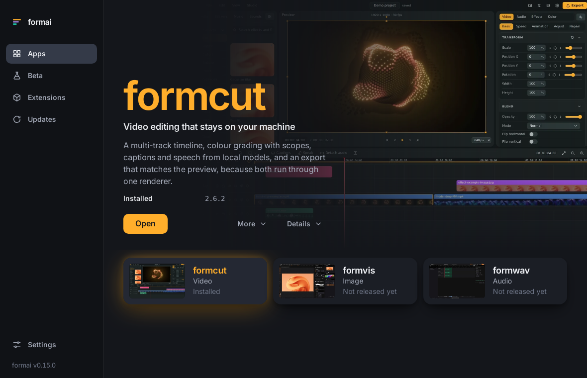

<h1 align="center">FormPortal</h1>

<p align="center"><b>One place to install, open, update and roll back every Form app: no account, no background process, GPL-3.0.</b></p>

<p align="center">
  
  
  
  
  
  
</p>

<p align="center"></p>

FormPortal reads the signed family catalogue formcompiler (`nodemode-ai/formcompiler`, where every Form app is released) publishes and offers this computer the right build of every Form app: FormCut, FormVis, FormLit, FormDesign, FormPath, FormVFX, FormEncoder, FormWav, Form.md, FormDAM, FormSlide, FormPDF, FormTxt, FormCel, FormRef, FormSculpt, Format and the apps on the way, plus the family tools formMCP, formskills and FormTray. It checks each download's SHA-256 before unpacking, installs per user with no administrator (zip, AppImage, deb, rpm, dmg, msi or NSIS), keeps the version it replaced so one step back is always there, and keeps a beta beside the stable build. The same engine runs the window, a command line and an MCP server, so Claude Code, Codex and Cursor can manage the family too.

**Stack:** Rust (`formportal-core`, `formportal-cli`) · Tauri 2 shell · vanilla TypeScript + Vite interface · **Scale:** 33 MCP tools, 20 apps from one registry, one shared tokens file, zero runtime dependencies in the interface

## Highlights

- **One engine, three surfaces.** `core/` does catalogue, verify, install, rollback, remove and launch with no window in it; `src-tauri/` (the window) and `cli/` (commands and MCP) are thin layers over it, so an agent and a person see the same installs
- **Trust you can check.** An Ed25519-signed catalogue, a SHA-256 per file refused before unpacking on mismatch, https or this computer only. No flag skips the hash
- **Rollback, betas side by side.** Every update keeps the version it replaced; each channel (stable, beta, nightly) is its own install
- **Nothing resident.** No account, no tray process, and no login item unless you turn on Open FormPortal when I log in. FormPortal checks when it is open and stops when you close it
- **Agent ready.** `./formportal mcp` serves `status`, `apps`, `app_info`, `installs`, `install`, `versions`, `updates`, `update`, `preferences`, `extensions`, `extension_install`, `extension_remove`, `extension_enable`, `policy`, `app_agents`, `connect_agents`, `files`, `folders`, `open_file`, `file_versions`, `storage`, `fonts`, `font_install`, `font_remove`, `media`, `media_save`, `media_remove`, `learn`, `learn_progress`, `repair`, `open`, `rollback`, `remove`; `.mcp.json`, `.codex/config.toml` and `.cursor/mcp.json` are wired, and the `formportal-harness` skill teaches the workflow. A Form app that ships its own MCP server is connected to Claude Code, Codex and Cursor in one step, and stays connected across its updates; FormPortal reads an app's `form-app.json` in format 1 or 2 (2 adds the app's skills) and the catalogue's per-release skills archive and digest (see `.docs/wiki/Agents.md`)
- **A calm layout, without the marketing.** A two-level sidebar (Home, Apps with Updates and Beta, Extensions, Learn), search, a notifications bell and Preferences in the top bar, Home built around the apps you have, Apps as a list with one action each and a More menu, and Preferences as a dialog with a switch per app
- **Files on your own disk.** Pick folders; FormPortal lists your Form projects, opens each in the right app, keeps a version each time you save while it is open (up to 20 to go back to), shows previews the apps write, and shows what it uses on disk. No cloud
- **Fonts without an account.** Open-licensed families from a signed index, or your own TTF and OTF files, installed for you alone with no administrator
- **Everything included, nothing to buy.** Included lists what the free plan covers (every app, every update, no account, no offers) with each app's licence; an extension can carry a link to support its maker, and your public links gather on a portfolio page in your own GitHub account
- **Learn, and ask your own agent.** Step-by-step tutorials with progress kept on your computer, suggestions on Home worked out locally, notifications filed by kind, and Ask your agent: Claude Code or Codex answers questions about your apps through FormPortal's reading-only server
- **Repair, later, and links from the web.** Check and repair finds and fixes broken installs and leftovers (silently from the command line too); an update can wait until you close the app; a web page can hand a Form project file to the right app, after you say yes
- **Your language, your starting screen.** English and a Spanish draft, chosen before the window opens so the first frame is already in that language; open on Home or where you left off
- **Stock and templates with their credits.** Open-licensed images, video, audio and Form app templates from a signed index, saved to your Library with the credit line beside each file; a template opens in its app in one step. No paid stock, no generative AI
- **Built from the registry.** Every app's row, card, page and switch is written at build time from `catalog/products.json`, so the first frame is the final layout (layout shift 0 under 4x CPU throttling)

## Quick Start

### Requirements

Node 20.19 or newer, Rust stable, git. On Linux the window needs WebKitGTK 4.1 and the D-Bus headers for the keychain (`libwebkit2gtk-4.1-dev librsvg2-dev libssl-dev libdbus-1-dev pkg-config build-essential`).

### macOS & Linux

```shell
chmod +x formportal formportal_oc_install
./formportal_oc_install   # checks Node, Rust and WebKitGTK; installs the interface; fetches the crates
./formportal              # opens the FormPortal window; closing it stops everything it started
```

The first boot compiles the shell, which takes a few minutes. Until formcompiler publishes its signed catalogue and this build trusts its key, run formai_dev's site locally and set the catalogue address in Settings to `http://127.0.0.1:8240/catalog/v1/apps.json` with the Developer box ticked.

### Windows

```shell
formportal_oc_install.bat
formportal.bat
```

### Agents and the command line

```shell
./formportal mcp                     # the MCP server on stdio (built on first use)
./formportal agents install          # add it and the skill to your Claude Code, Codex and Cursor
./formportal cli apps                # the family and what this computer is offered
./formportal cli install formcut --channel beta
```

In this repository the three clients are already configured. See `AGENTS.md`.

### The interface alone, in a browser

```shell
cd frontend && npm run dev           # http://localhost:3250, on the sample catalogue
```

### Ports

| Service | URL | Notes |
|---|---|---|
| Interface | http://localhost:3250 | Vite dev server, `server.host` false; the shell's debug build loads it |
| Interface preview | http://localhost:3251 | `npm run preview` |

The MCP server uses stdio, no port.

## Configuration

| Variable | Purpose |
|---|---|
| `FORMPORTAL_ROOT` | Install folder (default: `~/Library/Application Support/dev.formai.portal`, `%LOCALAPPDATA%\FormPortal`, `~/.local/share/formportal`) |
| `FORMPORTAL_CATALOG` | Default catalogue for the command line and MCP server |
| `FORMPORTAL_ALLOW_UNSIGNED` | `1` accepts an unsigned catalogue (development only) |
| `FORMAI_CATALOG_PUBKEY` | Extra trusted catalogue keys, base64, comma separated |
| `FORMPORTAL_POLICY` | A policy file to try when no system policy exists (organisations put theirs in `/etc/formportal`, `/Library/Application Support/FormPortal` or `%ProgramData%\FormPortal`; see the Organisations wiki page) |
| `FORMPORTAL_MIRROR_KEY` | Base64 Ed25519 seed that `formportal cli mirror` signs a mirrored catalogue with |

### The catalogue key

FormPortal installs only from a catalogue signed with a key it trusts. Trusted public keys are the lines of `core/catalog_keys.txt`, compiled in. To make the pair, run `python -m app.signing` in formai_dev's `site/backend`: the private seed goes into the site's `FORMAI_CATALOG_KEY` and nowhere else, the public key goes on a line of `core/catalog_keys.txt`. The file ships empty until formai.dev's key is published.

## Repository

| Path | What it is |
|---|---|
| `core/` | `formportal-core`, the engine |
| `cli/` | `formportal-cli`, commands and the MCP server |
| `src-tauri/` | the Tauri 2 shell |
| `frontend/` | the interface |
| `catalog/`, `design/` | copies of formai_dev's catalogue contract and design tokens |
| `setup/` | build, packaging and agent scripts |
| `.claude/skills/` | `formportal-harness` (using FormPortal) and `formportal-skillset` (changing it) |
| `.docs/` | wiki pages and the branching model |

## Docs

Wiki pages live in `.docs/wiki` (Home, Getting Started, Architecture, Agents, Releasing). Contributors: `.docs/BRANCHING.md`. Agents: `CLAUDE.md`, `AGENTS.md`.

## License

FormPortal is licensed under the GNU General Public License v3.0 (`LICENSE`, SPDX `GPL-3.0-only`), as ComfyUI, formpromo, formMCP and formskills are. Copyright 2026 NodeAgentc, Inc. See `LICENSE`, `NOTICE` and `LICENSES.md`.

## Trademarks

Adobe and Creative Cloud are either registered trademarks or trademarks of Adobe in the United States and/or other countries. Product names shown beside Form apps (for example in Learn) belong to their owners. FormPortal is not affiliated with or endorsed by Adobe or any of them.
