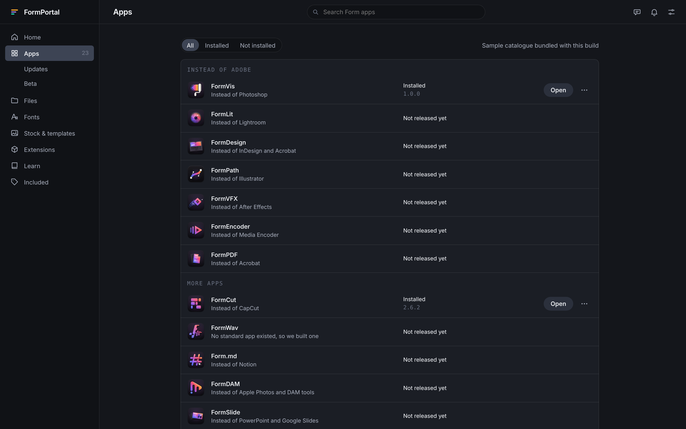
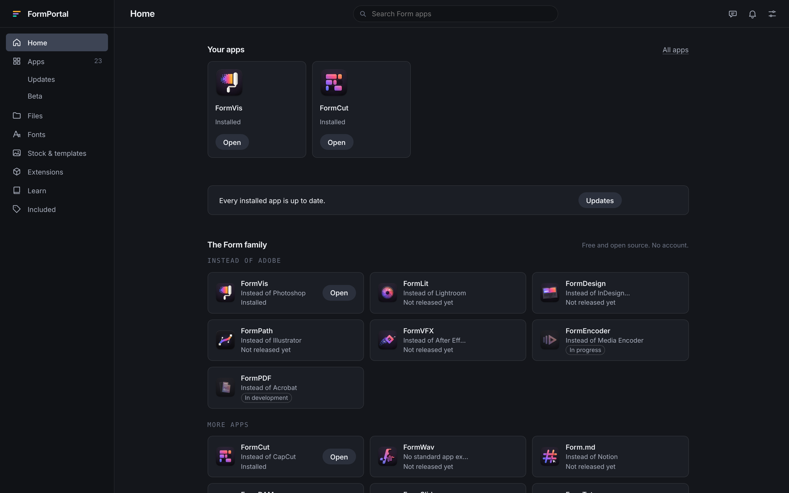
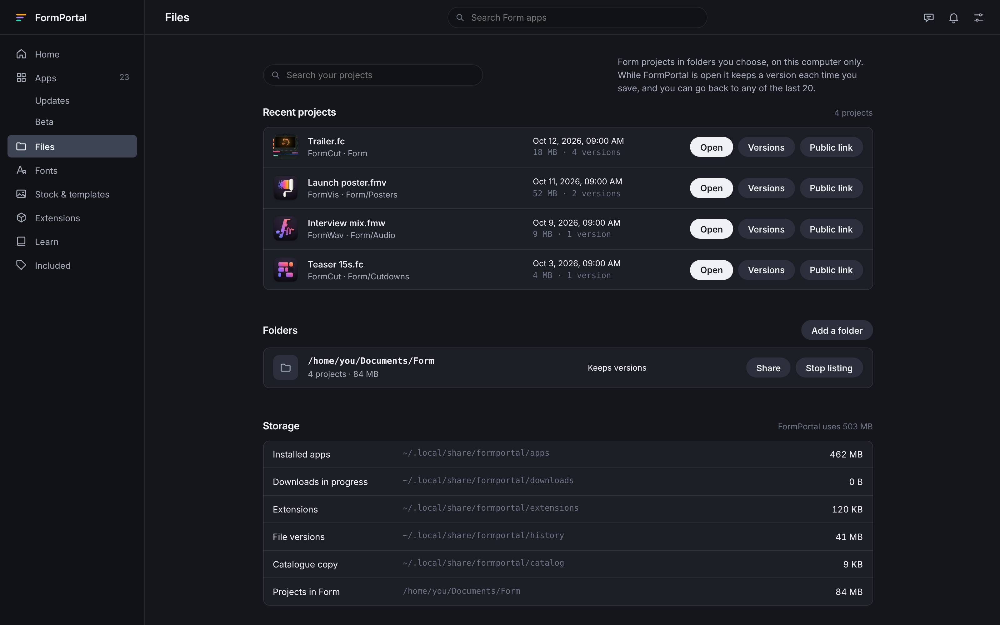
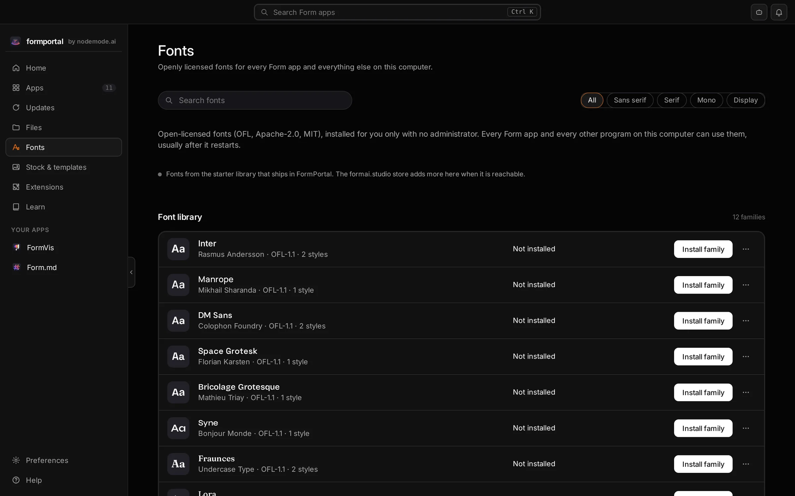
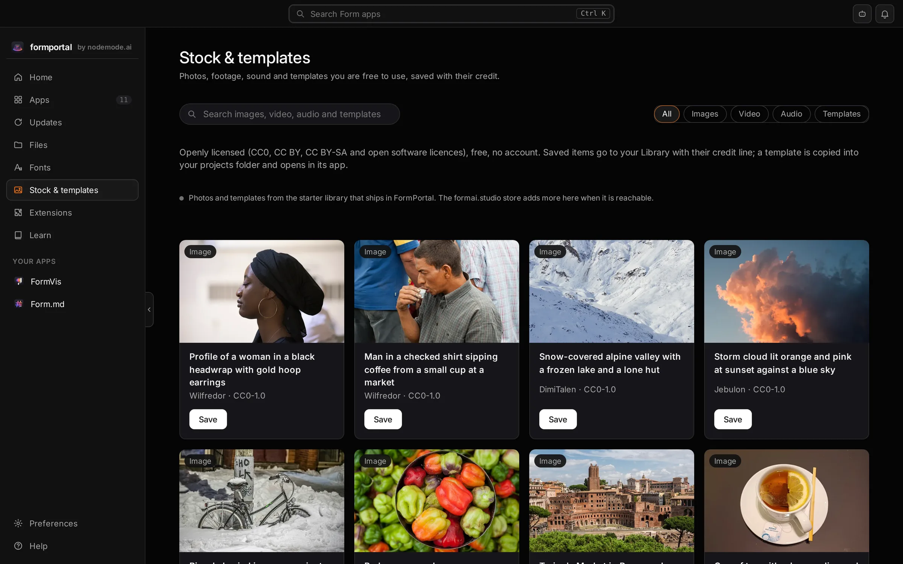

<p align="center"></p>

<h1 align="center">FormPortal</h1>

<p align="center">
  <b>App management; one place to install, update and roll back every Form app.</b><br>
  Signed catalogue, SHA-256 checks, one step back after every update,<br>
  with no account and no background process. Free and open source.
</p>

<p align="center">
  
  
  
  
  
  
</p>

<p align="center">
  <a href="https://formportal.formai.studio/"><b>Download FormPortal on formai.studio</b></a> ·
  <a href="https://github.com/nodemode-dev/formcompiler/releases/tag/formportal-v0.53.5">Latest release</a> ·
  <a href="#run-it-from-source">Run it from source</a> ·
  <a href="#the-form-family">All Form apps</a>
</p>

<br>

<p align="center">
  
  <br><sub>The app library: every Form app with its icon, what it replaces, its install state and one action.</sub>
</p>

<p align="center">
  <a href="#features">Features</a> · <a href="#everything-in-the-box">In the box</a> · <a href="#built-for-agents">Agents</a> · <a href="#under-the-hood">Under the hood</a> · <a href="#download">Download</a> · <a href="#run-it-from-source">Run from source</a> · <a href="#the-form-family">Form family</a>
</p>

<br>

<table>
  <tr>
    <td width="25%" valign="top"><h3>Rollback built in</h3>Every update keeps the version it replaced, so one step back is always there. Betas install beside the stable build.</td>
    <td width="25%" valign="top"><h3>Checked before unpacking</h3>The catalogue is Ed25519-signed and every download's SHA-256 must match before anything is unpacked.</td>
    <td width="25%" valign="top"><h3>Nothing resident</h3>No account and no tray process. FormPortal checks when it is open and stops when you close it.</td>
    <td width="25%" valign="top"><h3>Agent-ready</h3>The same engine runs the window, a command line and an MCP server, so Claude Code, Codex and Cursor can manage the family.</td>
  </tr>
</table>

<br>

## Features

<table>
  <tr>
    <td width="50%" valign="top">
      
      <br><sub>Home shows the apps you have first, then the family.</sub>
      <h3>Home built around your apps</h3>
      Open an installed app in one click and see at a glance whether everything is up to date.
    </td>
    <td width="50%" valign="top">
      
      <br><sub>Projects from the folders you choose, opened in the right app.</sub>
      <h3>Your files, with history</h3>
      FormPortal lists your Form projects and, while open, keeps a version each time you save, up to 20 to go back to.
    </td>
  </tr>
  <tr>
    <td width="50%" valign="top">
      
      <br><sub>Open-licensed fonts, installed for you alone.</sub>
      <h3>Fonts without an account</h3>
      Install families from a signed index, or your own TTF and OTF files, with no administrator.
    </td>
    <td width="50%" valign="top">
      
      <br><sub>Stock and templates, each saved with its credit line.</sub>
      <h3>Stock and templates</h3>
      Openly licensed images, video, audio and Form app templates. A template opens in its app in one step.
    </td>
  </tr>
</table>

## Everything in the box

<table>
  <tr>
    <td width="33%" valign="top"><h4>39 MCP tools</h4>status · apps · install · update · rollback · remove · open · files · fonts · media · learn · repair · policy</td>
    <td width="33%" valign="top"><h4>In the window</h4>Home · Apps · Updates · Beta · Files · Fonts · Stock &amp; templates · Extensions · Learn · Included</td>
    <td width="33%" valign="top"><h4>Install formats</h4>zip · AppImage · deb · rpm · dmg · msi · NSIS, per user, with no administrator</td>
  </tr>
</table>

## Built for agents

The window, the command line and the MCP server call one engine in `core/`, so an agent and a person see the same installs.

```sh
./formportal cli apps                             # the family and what this computer is offered
./formportal cli install formcut --channel beta   # install the beta beside the stable build
./formportal agents install                       # add FormPortal and its skill to Claude Code, Codex and Cursor
./formportal mcp                                  # MCP server on stdio for Claude Code, Codex and Cursor
```

`.mcp.json`, `.codex/config.toml` and `.cursor/mcp.json` are already wired in this repo. See [`AGENTS.md`](AGENTS.md).

## Under the hood

- **One engine:** `formportal-core` does catalogue, verify, install, rollback, remove and launch with no window in it.
- **Thin layers:** `src-tauri/` is the window and `cli/` holds the commands and the MCP server, both over the core.
- **Install record:** after each install FormPortal records every installed file's SHA-256, which FormMCP checks before it starts the app.
- **Built from a registry:** every app's row and card is written at build time from `catalog/products.json`.
- **Tested:** 50 Rust tests (catalogue trust, install lifecycle, version order, extension trust, open links, CLI).

## Download

**Get the app:** download FormPortal from [formai.studio](https://formportal.formai.studio/). That is the easiest way to install it.

**Latest release:** [formportal 0.53.5](https://github.com/nodemode-dev/formcompiler/releases/tag/formportal-v0.53.5) in [`nodemode-dev/formcompiler`](https://github.com/nodemode-dev/formcompiler/releases).

| Platform | Builds |
|---|---|
| macOS | Apple silicon, Intel |
| Linux | x64, arm64 |
| Windows | x64, arm64 |

All FormPortal builds are compiled and released from [`nodemode-dev/formcompiler`](https://github.com/nodemode-dev/formcompiler/releases), not from this repo. This repo holds the source.

## Run it from source

Prefer it in your browser, or want to contribute? Run the web UI straight from this repo.

**Requires:** Node 20.19 or newer, Rust stable, git. On Linux the window also needs WebKitGTK 4.1 and `libdbus-1-dev`.

```sh
git clone git@github.com:nodemode-dev/formportal.git
cd formportal/frontend
npm ci              # installs the interface
npm run dev         # web UI at http://localhost:3250, on the sample catalogue
```

`./formportal_oc_install` then `./formportal` opens the desktop window instead (`.bat` files on Windows). The first start compiles the shell. The web UI runs on localhost:3250 only; `npm run preview` serves it on 3251.

> [!IMPORTANT]
> **Status:** in development. The browser preview runs on a bundled sample catalogue, so installs there are simulated. See [`.docs/wiki/Releasing.md`](.docs/wiki/Releasing.md).

**Contributing:** branch from `main`, keep changes to source here, and leave packaging and releases to formcompiler. See [`.docs/BRANCHING.md`](.docs/BRANCHING.md) and [`AGENTS.md`](AGENTS.md).

## Repository

| Path | What it is |
|---|---|
| `core/` | `formportal-core`, the engine |
| `cli/` | `formportal-cli`, commands and the MCP server |
| `src-tauri/` | the Tauri 2 shell |
| `frontend/` | the interface (vanilla TypeScript and Vite) |
| `catalog/`, `design/`, `setup/` | catalogue contract, design tokens, build and agent scripts |

Docs: [`.docs/wiki`](.docs/wiki) · Agents: [`CLAUDE.md`](CLAUDE.md), [`AGENTS.md`](AGENTS.md)

## The Form family

FormPortal is one of the **Form apps**: native creative tools that install, update and roll back through FormPortal and can all be driven by agents.

| | App | What it's for | Download | Code |
|:-:|---|---|---|---|
|  | **form.md** | Documents, databases and realtime editing together | [formai.studio](https://formmd.formai.studio/) | [GitHub](https://github.com/nodemode-dev/form.md) |
|  | **FormAT** | Chat and agent workspace on your key | [formai.studio](https://format.formai.studio/) | [GitHub](https://github.com/nodemode-dev/format) |
|  | **FormCAD** | Drafting, parametric parts and NURBS surfaces | | [GitHub](https://github.com/nodemode-dev/formCAD) |
|  | **FormCel** | Spreadsheets agents can read and edit | [formai.studio](https://formcel.formai.studio/) | [GitHub](https://github.com/nodemode-dev/formcel) |
|  | **FormCraft** | Generate images, video, audio, 3D and worlds | | [GitHub](https://github.com/nodemode-dev/formcraft) |
|  | **FormCut** | Multi-track video editing with no upload | [formai.studio](https://formcut.formai.studio/) | [GitHub](https://github.com/nodemode-dev/formcut) |
|  | **FormDAM** | Photo library and asset manager | [formai.studio](https://formdam.formai.studio/) | [GitHub](https://github.com/nodemode-dev/formDAM) |
|  | **FormDeck** | Presentations and pitch decks | [formai.studio](https://formdeck.formai.studio/) | [GitHub](https://github.com/nodemode-dev/formdeck) |
|  | **FormDesign** | Page layout for print and the web | [formai.studio](https://formdesign.formai.studio/) | [GitHub](https://github.com/nodemode-dev/formdesign) |
|  | **FormEncoder** | Media encoding queue with presets | [formai.studio](https://formencoder.formai.studio/) | [GitHub](https://github.com/nodemode-dev/formencoder) |
|  | **FormFabric** | Sewing patterns draped with cloth simulation | | [GitHub](https://github.com/nodemode-dev/formfabric) |
|  | **FormLit** | Photo library and raw development | [formai.studio](https://formlit.formai.studio/) | [GitHub](https://github.com/nodemode-dev/formlit) |
|  | **FormMorpheus** | Frame-by-frame and performed animation | | [GitHub](https://github.com/nodemode-dev/formmorpheus) |
|  | **FormNET** | See what your computer sends online | | [GitHub](https://github.com/nodemode-dev/formNET) |
|  | **FormPath** | Vector illustration with artboards and type | [formai.studio](https://formpath.formai.studio/) | [GitHub](https://github.com/nodemode-dev/formpath) |
|  | **FormPDF** | Edit, redact, sign and fill PDFs | [formai.studio](https://formpdf.formai.studio/) | [GitHub](https://github.com/nodemode-dev/formpdf) |
|  | **FormPromo** | Promo films from your own media | [formai.studio](https://formpromo.formai.studio/) | [GitHub](https://github.com/nodemode-dev/formpromo) |
|  | **FormRef** | Reference boards for creative work | [formai.studio](https://formref.formai.studio/) | [GitHub](https://github.com/nodemode-dev/formref) |
|  | **FormRig** | Rig, skin and retarget any mesh | | [GitHub](https://github.com/nodemode-dev/formrig) |
|  | **FormSculpt** | 3D sculpting, remeshing and painting | [formai.studio](https://formsculpt.formai.studio/) | [GitHub](https://github.com/nodemode-dev/formsculpt) |
|  | **FormSurface** | Texture painting with PBR export | [formai.studio](https://formsurface.formai.studio/) | [GitHub](https://github.com/nodemode-dev/formsurface) |
|  | **FormTools** | Viewers, batch tools and file utilities | | [GitHub](https://github.com/nodemode-dev/formtools) |
|  | **FormTxt** | Word processing with .docx round trips | [formai.studio](https://formtxt.formai.studio/) | [GitHub](https://github.com/nodemode-dev/formtxt) |
|  | **FormVFX** | Motion graphics and VFX compositing | [formai.studio](https://formvfx.formai.studio/) | [GitHub](https://github.com/nodemode-dev/formvfx) |
|  | **FormVis** | Layered image editing with local AI | [formai.studio](https://formvis.formai.studio/) | [GitHub](https://github.com/nodemode-dev/formvis) |
|  | **FormWav** | Multitrack audio editing and mixing | [formai.studio](https://formwav.formai.studio/) | [GitHub](https://github.com/nodemode-dev/formwav) |
|  | **FormWeb** | Visual website building with a CMS | [formai.studio](https://formweb.formai.studio/) | [GitHub](https://github.com/nodemode-dev/formweb) |
|  | **FormPortal** | Install, update and roll back Form apps | [formai.studio](https://formportal.formai.studio/) | [GitHub](https://github.com/nodemode-dev/formportal) |
|  | **FormTray** | One dock icon for every app | [formai.studio](https://formtray.formai.studio/) | [GitHub](https://github.com/nodemode-dev/formtray) |
|  | **FormMCP** | One MCP connection to the family | [formai.studio](https://formmcp.formai.studio/) | [GitHub](https://github.com/nodemode-dev/formMCP) |
|  | **FormSkills** | Every app's agent skills in one place | [formai.studio](https://formskill.formai.studio/) | [GitHub](https://github.com/nodemode-dev/formskills) |
|  | **FormBench** | Parity, testing and rankings for the family | [formai.studio](https://formranker.formai.studio/) | [GitHub](https://github.com/nodemode-dev/formbench) |
|  | **FormSlot** | Codebase memory for coding agents | | [GitHub](https://github.com/nodemode-dev/formslot) |
|  | **SubForm** | Workbench for parallel Claude Code agents | | [GitHub](https://github.com/nodemode-dev/subform) |
|  | **FormCompiler** | Builds, signs and releases every app | [formai.studio](https://formcompiler.formai.studio/) | [GitHub](https://github.com/nodemode-dev/formcompiler) |
|  | **FormPipe** | Release pipeline and update feeds | | [GitHub](https://github.com/nodemode-dev/formpipe) |

---

## Maintainers

| Maintainer | Role |
|---|---|
| [@nodemode-ai](https://github.com/nodemode-ai) | Owner |
| [@gbarnai](https://github.com/gbarnai) | Co-owner |

Code owners are set in [`.github/CODEOWNERS`](.github/CODEOWNERS).

## License

FormPortal is licensed under the GNU General Public License v3.0 ([`LICENSE`](LICENSE), SPDX `GPL-3.0-only`). Copyright 2026 NodeAgentc, Inc. Third-party notices: [`NOTICE`](NOTICE), [`LICENSES.md`](LICENSES.md).

<sub>Screenshots show the bundled sample catalogue. Adobe and Creative Cloud are trademarks of Adobe; FormPortal is not affiliated with or endorsed by Adobe or any company named in its catalogue.</sub>
